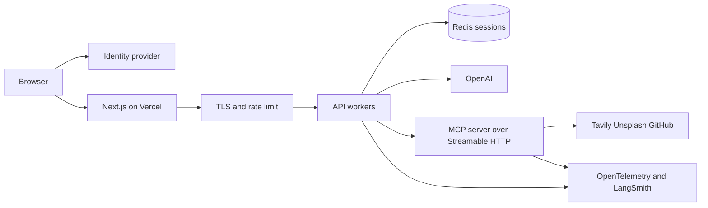

# Productionizing the MCP Server App

The Docker Compose stack in this repo is a local workshop. It is the right shape to demo the chat, and the wrong shape to put on the public internet. This note is the path from one laptop to a service other people can use.

Nothing here is implemented yet. Each section is a change you can make, in the order that removes the most risk first.

## What is true today

- The UI on port 3000 and the API on port 8000 have no authentication. Anyone who can open the port can run tools, including tools that spend Tavily or OpenAI quota.
- Chat transcripts live in the API process (`api/sessions.py`). A restart deletes them. A second replica cannot see them.
- LangGraph mode spawns one stdio child (`python run_server.py`) per API process, from `client/langgraph_agent.py`. The child is not a service you can scale, health-check, or roll independently.
- Local mode calls tools in-process. That path does not need the child, and it is what `./scripts/verify_docker.sh` exercises.
- Secrets are environment variables. `.env` is gitignored. `.env.sample` holds placeholders, and the code ignores values that still look like those placeholders.
- Logs are unstructured prints from the agent plus Uvicorn's access log. There is no trace id tying a browser request to a tool call.
- The images run as non-root, which is a start. They are not scanned, signed, or published.

## Target shape



The browser still never holds an API key. The Next.js app keeps proxying to the API, but only after a session exists. The API keeps the model and the tool policy. The MCP server becomes its own HTTP service so you can run more tool workers than chat workers. Redis holds transcripts so any API replica can continue a session. Telemetry sits beside both services instead of inside a print statement.

## 1. CI before the first deploy

Add `.github/workflows/ci.yml` that runs on pull requests:

1. `uv sync` and `uv run pytest tests/ -q` on Python 3.13. The OpenAI integration tests already skip when no key is present. Do not put a real key in this job.
2. `docker compose build` so a broken Dockerfile fails the PR.
3. `AGENT_MODE=local ./scripts/verify_docker.sh` on a runner that has Docker. This is the same check used locally. It rolls dice through the API and loads the chat page.

Keep a second, scheduled workflow for a live smoke test: one `POST /api/chat` with `AGENT_MODE=openai` and secrets stored in GitHub Actions environments, not in the repo. Alert on failure. Do not run that job on every push.

Pin image tags in Dockerfiles (`python:3.13-slim` and `node:22-alpine` should become digests once you care about reproducible builds). Cache `uv` and `npm ci` between runs.

A minimal pull-request job, once you are ready to add the file:

```yaml
name: ci
on:
  pull_request:
jobs:
  pytest:
    runs-on: ubuntu-latest
    steps:
      - uses: actions/checkout@v4
      - uses: astral-sh/setup-uv@v5
        with:
          python-version: "3.13"
      - run: uv sync
      - run: uv run pytest tests/ -q
```

Add the Docker job only on runners where privileged Docker is acceptable. Do not bake `.env` into the workflow.

## 2. Authentication and authorization

Do this before any host has a public DNS name.

- Put the Next.js app behind an identity provider. Auth.js or Clerk both fit a Next.js app on Vercel. Require a signed-in session in `web/app/backend/[...path]/route.ts` and return 401 before the proxy forwards.
- Give the API a shared bearer token or, better, verify the same session cookie or JWT the UI uses. Reject `POST /api/chat` and `POST /api/tools/call` without it. `/health` can stay public and must keep returning no secrets.
- Split permissions. Most people should get chat. Direct tool invocation (`/api/tools/call`) can spend quota and read GitHub files. Gate it on a separate role, or drop it from the public UI and keep it on an internal network.
- Cap request size (already 8000 characters on chat), add a per-user rate limit, and set a timeout on agent turns so one prompt cannot hold a worker open.
- The stdio MCP server must keep listening only on its pipes. Do not publish it.

Keys stay server-side. The UI does not have a box for `OPENAI_API_KEY` and should not grow one.

## 3. Hosting

Two honest options.

**One box, soon.** Run the existing Compose file on a single VM (a small Fly machine, a Railway service pair, or an ECS task for each image). Put Caddy or the platform's load balancer in front, TLS on 443, and only publish the web port. This is fine for a handful of people. You still have in-memory sessions and a stdio child, so run exactly one API replica.

**Split, when more than one person depends on it.**

- Web: Vercel. The app is already a Next.js standalone build. Set `API_INTERNAL_URL` to the private API origin. Because that variable is read in the route handler, a change does not require guessing at build-time `NEXT_PUBLIC_*` values.
- API: a container platform that allows long-lived processes and outbound HTTPS. LangGraph turns are much slower than a normal request, so raise the proxy idle timeout above the longest tool chain you allow (start at 60 seconds, measure, then set a hard cap in the API).
- MCP: change `server/main.py` from `mcp.run(transport="stdio")` to Streamable HTTP, bind it to a private network, and point `MCPLangGraphAgent` at that URL instead of a command. `langchain-mcp-adapters` already accepts an HTTP connection. Do this before you run more than one API replica, or you will spawn one silent child per replica and never notice until a key is missing in one of them.

Do not commit a production `.env`. On the host, use the platform's secret store and the same variable names as `.env.sample`.

Images: build in CI, scan with Trivy or Grype, sign with cosign, and deploy the digest. The Dockerfiles already run as non-root (`appuser` and `nextjs`). Keep it that way. Add a read-only root filesystem once you confirm pytest and Uvicorn do not need to write beside the code. They should not, in production.

## 4. Observability

You want one id per browser send, visible on the API log line, the model call, and each tool call.

- Generate a request id in the Next.js proxy and forward it as `X-Request-ID`. Log it in FastAPI middleware. Return it in error JSON so a person can quote it.
- Export OpenTelemetry traces from the API. `opentelemetry-api` is already a dependency of the MCP stack. Add the SDK and an OTLP exporter, and point `OTEL_EXPORTER_OTLP_ENDPOINT` at your collector. Span the chat route, the agent invocation, and each tool call.
- For the model path, set `LANGCHAIN_TRACING_V2=true` and `LANGCHAIN_API_KEY` (both already in `.env.sample`) and use a project name per environment (`mcp-server-app-prod`). LangSmith shows the prompt, the tool choice, and the tool result. Treat those traces as sensitive: they contain user text.
- Turn the agent's `print` calls into structured logs at info, and log failures with the request id. Do not log environment variables or the Authorization header.
- Alert on `/health` returning `"ready": false`, on chat 5xx rate, on tool error rate, and on OpenAI and Tavily 429s. The health payload already distinguishes `ok` and `degraded` without calling the model, so a liveness probe can stay on `/health` and a readiness gate can require `"ready": true`.
- Dashboard the boring numbers: chat latency, tokens, tool latency by name, and active sessions.

## 5. Scaling

Do these in order. Skipping ahead strands sessions or tool processes.

1. **Move sessions to Redis.** Replace `SessionStore` with a client that stores the same JSON transcript under `session:{id}` and sets a TTL (a day is plenty for this app). Keep the 40-message cap. After this, API replicas are safe.
2. **Cap concurrency per replica.** A LangGraph turn holds a worker and, today, shares one MCP child. Run Uvicorn with a small number of workers only after the MCP server is HTTP and stateless. Until then, one worker per container, and scale by adding containers.
3. **Split the MCP server onto Streamable HTTP** as described above. Scale it on tool CPU and outbound API rate limits, not on chat traffic. GitHub's unauthenticated limit will be the first ceiling. A single `GITHUB_TOKEN` for the service, stored as a secret, is the fix. Do not reuse a developer's personal token.
4. **Time out and bound tool calls.** Dice already caps repeats at 20 in the local router. Put the same kind of bound on the agent path: max tool rounds per turn, max output bytes stored in the session, and a deadline that returns a partial answer instead of hanging the UI.
5. **Cache read-only tool results** where it is honest. GitHub file reads and repository info can take a short TTL. Dice rolls and web search should not be cached across users.
6. **Ship the web and the API on separate release trains** once the HTTP contract is stable. The contract is the JSON in `api/app.py`. Add a contract test that the UI's `web/lib/types.ts` fields stay aligned with those models. Breaking that silently breaks the chat.

Sticky sessions are a fallback if Redis is not ready. They are not a plan. The moment a replica dies, those users lose the transcript.

## 6. Secrets and supply chain

- Keep using `.env.sample` as the checklist. Production values live in the host's secret manager (Doppler, 1Password, AWS SM, GitHub environments). The deploy injects them as env vars. The image build must not receive them: Dockerfiles here do not copy `.env`, and `.dockerignore` excludes it. Leave it that way.
- Rotate `OPENAI_API_KEY`, `TAVILY_API_KEY`, and `GITHUB_TOKEN` on their own schedule. The app reads them from the environment at call time for Tavily and at agent construction for OpenAI, so a new process picks up a rotation. Document that a rotation means a rolling restart.
- Placeholder rejection in `server/main.py` (`_optional_secret`) and `api/config.py` (`openai_key_is_usable`) should stay. A sample file accidentally copied into a production environment must not be sent to GitHub as a bearer token.
- Pin dependencies with `uv.lock` and `web/package-lock.json`, which this repo already commits. Renovate or Dependabot can open the bumps. `npm audit` currently reports transitive issues in the Next.js tree. Triage those in CI instead of ignoring the command.
- Add a `LICENSE` file. The README notes that the project has been described as MIT and that the file is missing.

## Suggested order of work

1. CI: pytest on every PR, Docker verify on main.
2. Auth on the proxy and the API. Rate limit. Remove public tool-run or restrict it.
3. Request ids, structured logs, LangSmith in production, an alert on `/health`.
4. Redis sessions, one API replica still.
5. Streamable HTTP MCP, then horizontal scale.
6. Image scanning, digest deploys, secret rotation runbook.

After step 2 the Compose file is still how you develop. Production should not be `docker compose up` on a laptop with ports 3000 and 8000 open to the world.
