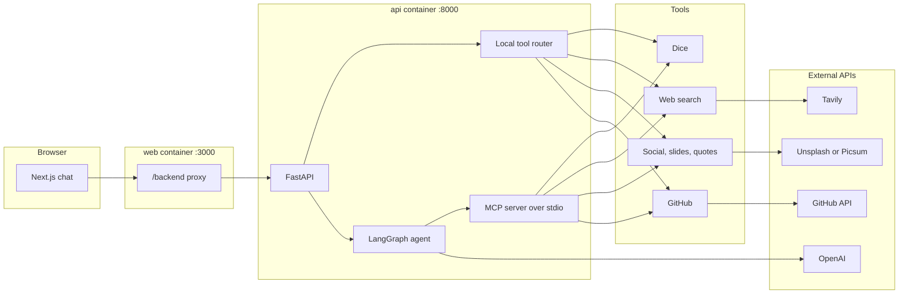
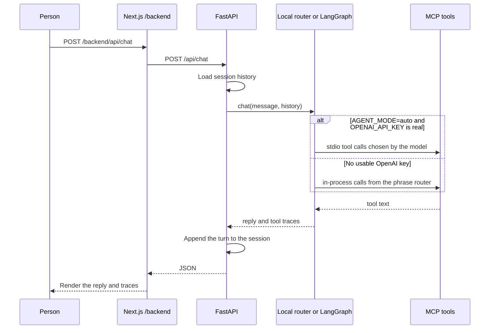

<p align="center"></p>

# MCP Server App

A Model Context Protocol server, a LangGraph agent that can call it, and a browser chat so you can use both without a terminal.

Roll dice, search the web, draft a social post, pull a slide image, mint a quote card, or browse public GitHub repos. With an OpenAI key, a ReAct agent decides which tools to call. Without one, the same UI still runs the tools it can recognize (dice works immediately).

## Architecture

Two processes, one conversation.



The browser never talks to OpenAI or to the MCP server directly. It calls the Next.js app, which proxies to FastAPI. FastAPI either routes the message itself (local mode) or hands it to the LangGraph agent. The agent spawns `run_server.py` and speaks MCP over stdin/stdout, which is the same transport Cursor uses.

### What happens when you hit Send



Local mode is a small phrase router, not a model. "Roll 2d6" calls `roll_dice`. "Create a quote card about shipping" calls `create_quote_card`. Anything it does not recognize gets a short explanation of what to try. Set a real `OPENAI_API_KEY` and the LangGraph agent takes over, history included.

Direct tool runs from the sidebar skip the model entirely. `POST /api/tools/call` executes one registered tool and returns the text.

## What you can ask for

| Tool | What it does | Something to type |
| --- | --- | --- |
| `roll_dice` | D&D-style notation, including keep-highest (`2d20k1`) | Roll 2d6 |
| `web_search` | Live search through Tavily | Search the web for AI news |
| `create_social_post` | Post copy plus an image | Create a LinkedIn post about Python |
| `get_slide_image` | A presentation-sized image | Get a slide image about robots |
| `create_quote_card` | A quote and a background | Create a quote card about shipping |
| `github_search_repositories` | Search public GitHub repos | Search GitHub for langgraph |
| `github_get_repository_info` | Details for `owner/repo` | Used by the agent |
| `github_get_file_content` | Read a file from a repo | Used by the agent |
| `github_list_files` | List a directory in a repo | Used by the agent |
| `github_auth_status` | Token and rate-limit status | Used by the agent |

Web search needs `TAVILY_API_KEY`. Image tools use Unsplash when `UNSPLASH_ACCESS_KEY` is set, and Lorem Picsum otherwise. GitHub's public API works without a token. A token raises the rate limit and unlocks private repos.

## Project layout

```
.
├── server/                  # FastMCP tools
│   ├── main.py              # Tool registration and stdio entry
│   ├── dice_roller.py
│   ├── social_content_creator.py
│   └── github_tool.py
├── client/
│   └── langgraph_agent.py   # ReAct agent, StateGraph, stdio config
├── api/                     # Thin FastAPI layer for the browser
│   ├── app.py               # Routes
│   ├── backends.py          # Local router and OpenAI agent
│   ├── routing.py           # Phrase router used when no model is configured
│   ├── catalog.py           # In-process tool calls
│   └── sessions.py          # In-memory transcripts
├── web/                     # Next.js chat UI
│   ├── app/                 # Page, styles, /backend proxy
│   └── components/          # Chat and tool runner
├── tests/                   # Pytest, including API and stdio coverage
├── examples/                # Terminal demos
├── run_server.py            # MCP server (stdio)
├── run_client.py            # Terminal menu for the agent
├── run_api.py               # Chat API
├── Dockerfile               # API image
├── web/Dockerfile           # UI image
├── docker-compose.yml
├── .env.sample              # Placeholders only. Copy to .env.
└── PRODUCTIONIZING.md       # What to do before this faces the public internet
```

## Run it with Docker

This is the path to click around in a browser. You need Docker with Compose. You do not need Python or Node installed on the host.

**1. Configure keys**

```bash
cp .env.sample .env
```

Edit `.env` if you have keys. The file is gitignored. Placeholder values are safe to leave in place: the app treats `your_...` as "not configured" and starts in local tool mode.

**2. Start the stack**

```bash
docker compose up --build
```

**3. Open the chat**

[http://localhost:3000](http://localhost:3000)

The API is on [http://localhost:8000](http://localhost:8000). Interactive docs live at [http://localhost:8000/docs](http://localhost:8000/docs).

**4. Prove the stack**

In another terminal, from the repo root:

```bash
./scripts/verify_docker.sh
```

That builds the images, waits until both health checks pass, rolls dice through the API, loads the chat page, calls the UI proxy, and runs pytest inside the API container. It forces `AGENT_MODE=local` so the check does not spend OpenAI credit.

Stop the stack with `docker compose down`.

### What the containers are doing

- `api` runs `run_api.py` as a non-root user. On the first LangGraph chat it starts `python run_server.py` in the same container and talks MCP over stdio. The child inherits the container environment, including your API keys.
- `web` serves the Next.js app. Server-side requests to `/backend/*` go to `http://api:8000`. Your browser only talks to port 3000, so there is no CORS puzzle for the UI.

`AGENT_MODE` chooses the brain:

| Value | Behavior |
| --- | --- |
| `auto` (default) | LangGraph when `OPENAI_API_KEY` looks real, otherwise the local router |
| `local` | Always the local router |
| `openai` | LangGraph only. Chat returns 503 until a real key is set |

## Run it without Docker

Python 3.13 or newer, [uv](https://docs.astral.sh/uv/), and Node 22.

**1. Keys**

```bash
cp .env.sample .env
```

**2. API**

```bash
uv sync
uv run python run_api.py
```

The API listens on port 8000.

**3. UI**

```bash
cd web
npm install
npm run dev
```

`API_INTERNAL_URL` in `.env` defaults to `http://127.0.0.1:8000`, which is what the Next.js dev server proxies to. Open [http://localhost:3000](http://localhost:3000).

Production mode for the UI, still on your machine:

```bash
cd web
npm run build
API_INTERNAL_URL=http://127.0.0.1:8000 npm run start
```

**4. Tests**

```bash
uv run pytest tests/ -v
```

Tests that call OpenAI are skipped unless `OPENAI_API_KEY` is a real key. Dice, the HTTP API, the phrase router, and a real stdio MCP session run without any keys.

### The original terminal client

Still there, still useful when you want the agent without a browser:

```bash
uv run run_server.py          # stdio MCP server, for Cursor or a client
uv run run_client.py          # menu: examples, interactive chat, ReAct vs StateGraph
uv run pytest tests/ -v
```

`run_client.py` needs a real `OPENAI_API_KEY`. The browser's local mode does not.

## How the pieces are built

**Tools.** Each tool is a function in `server/` with an `@mcp.tool()` decorator in `server/main.py`. FastMCP publishes them over stdio when you run `run_server.py`. Tavily and GitHub clients are created only when a call needs them, and placeholder keys from `.env.sample` are ignored, so importing the server does not crash a fresh clone.

**Agent.** `MCPLangGraphAgent` in `client/langgraph_agent.py` builds a stdio connection, loads the tools through `langchain-mcp-adapters`, and wraps them in a ReAct agent and a StateGraph. `build_mcp_config()` is the one place that decides the command. Locally that is `uv run run_server.py`. In Docker it is `python run_server.py`, set with `MCP_COMMAND` and `MCP_ARGS`. The parent environment is forwarded on purpose: this version of the adapter would otherwise hand the child a process environment that only contains `PATH`, and the tools would not see your keys.

**API.** `api/app.py` exposes:

| Method | Path | Purpose |
| --- | --- | --- |
| GET | `/health` | Backend name, readiness, tool count. No secrets. |
| GET | `/api/tools` | Names and descriptions for the sidebar |
| POST | `/api/tools/call` | Run one tool with a JSON object of arguments |
| POST | `/api/chat` | One user turn. Returns a session id, the reply, and tool traces |
| GET | `/api/sessions/{id}` | Transcript |
| DELETE | `/api/sessions/{id}` | Forget a transcript ("New chat") |

Sessions live in memory inside one process. Restarting the API forgets them. That is called out in `PRODUCTIONIZING.md` because it is the wrong store for more than one replica.

**UI.** `web/components/chat-app.tsx` is the page. It loads health and the tool list together, sends chat through `/backend/api/chat`, and can run a tool from the sidebar with raw JSON arguments. `web/app/backend/[...path]/route.ts` proxies those calls. The browser bundle does not contain the API hostname, so changing `API_INTERNAL_URL` does not require a rebuild.

### Add a tool

1. Write the function under `server/`.
2. Register it in `server/main.py`:

```python
@mcp.tool()
def my_custom_tool(param: str) -> str:
    """Say what the tool does. The agent reads this."""
    return f"Processed: {param}"
```

3. Teach the local router in `api/routing.py` if the tool should work with no OpenAI key. The LangGraph agent picks up new tools on its next startup without a router change.
4. Add a test in `tests/`.
5. The sidebar lists whatever `list_tools()` returns, so the UI follows along.

### Use it from Cursor

Add this to `~/.cursor/mcp.json` and fix the path:

```json
{
  "mcpServers": {
    "mcp-server": {
      "command": "uv",
      "args": ["--directory", "/absolute/path/to/this/repo", "run", "run_server.py"]
    }
  }
}
```

Restart Cursor after saving. The chat UI and Cursor can both use the same server code. They are separate processes.

### Call the agent from Python

```python
import asyncio
from client.langgraph_agent import MCPLangGraphAgent

async def main():
    agent = MCPLangGraphAgent()
    await agent.initialize()
    print(await agent.chat("Roll 2d20 and tell me if that is a good omen"))
    print(await agent.chat_with_state_graph(
        "Research machine learning trends and prepare presentation materials"
    ))
    await agent.close()

asyncio.run(main())
```

`chat_detailed()` returns the reply plus the tool names, arguments, and results. The HTTP API uses that for the trace panel.

## Configuration

`.env.sample` lists every variable. The ones that matter day to day:

```bash
OPENAI_API_KEY=your_openai_api_key_here
TAVILY_API_KEY=your_tavily_api_key_here
UNSPLASH_ACCESS_KEY=your_unsplash_access_key_here
GITHUB_TOKEN=ghp_your_github_personal_access_token_here
AGENT_MODE=auto
OPENAI_MODEL=gpt-4o-mini
API_INTERNAL_URL=http://127.0.0.1:8000
```

GitHub token scopes, if you create one: `repo` for private repositories, `public_repo` for public ones. A missing token still allows public reads, within GitHub's unauthenticated rate limit.

Do not commit `.env`. The sample file is the only env file in git, and its values are placeholders.

## Tests

```bash
uv run pytest tests/ -v
```

The suite covers:

- Tool registration, dice notation, GitHub responses, and a missing Tavily key (`tests/test_server.py`)
- The phrase router (`tests/test_local_routing.py`)
- HTTP chat, sessions, direct tool calls, and the OpenAI-key fallback (`tests/test_api.py`)
- stdio command construction and tool-trace parsing (`tests/test_agent_config.py`)
- A live stdio child that lists tools and rolls a die (`tests/test_stdio_mcp.py`)
- LangGraph initialization, skipped unless an OpenAI key is present (`tests/test_mcp_integration.py`)

`./scripts/verify_docker.sh` repeats the pytest run inside the API image after the HTTP checks.

## Troubleshooting

**The chat page says the API is not reachable.**
The Next.js process proxies to `API_INTERNAL_URL`. For `npm run dev` that should be `http://127.0.0.1:8000` and `run_api.py` should be running. In Compose it is `http://api:8000` and it is set for you. Check `docker compose ps` and `docker compose logs api`.

**Every reply says local mode.**
`OPENAI_API_KEY` is missing or still the placeholder from `.env.sample`. Put a real key in `.env` and recreate the container (`docker compose up --build`) so the API process sees it. `GET /health` shows `"backend": "openai"` when the agent path is armed. The first real chat is what opens the connection.

**`AGENT_MODE=openai` and chat returns 503.**
That mode refuses to fall back. Either set a real key or switch the mode to `auto` or `local`.

**Web search says it is unavailable.**
Expected without `TAVILY_API_KEY`. Dice, quotes, slides, and public GitHub search do not need that key. Quotes fall back to a built-in list if the quote service is down.

**Docker says the port is in use.**
Something else is bound to 3000 or 8000. Stop it, or change the host side of the `ports:` mapping in `docker-compose.yml` (`"3001:3000"` leaves the container port alone).

**Cursor does not see the server.**
Use an absolute path in `mcp.json`, confirm `uv` is on the PATH Cursor inherits, and reload the window. The server speaks stdio, so it will look idle in a terminal until a client connects.

## Where this should go next

The Compose file is a local workshop, not a deployment. Sessions are in memory, the tool runner has no auth, and the MCP server is a child process of the API. [PRODUCTIONIZING.md](PRODUCTIONIZING.md) is the concrete list: CI, auth, hosting, observability, and how to scale the agent and the tools apart.

## License

This project has been described as MIT, and there is no `LICENSE` file in the tree yet. Add one before you publish a package or image.
